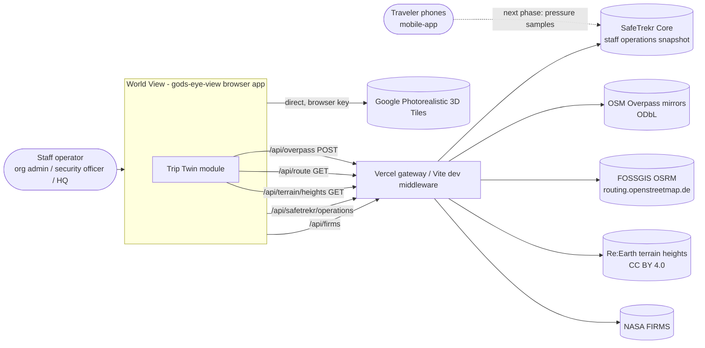
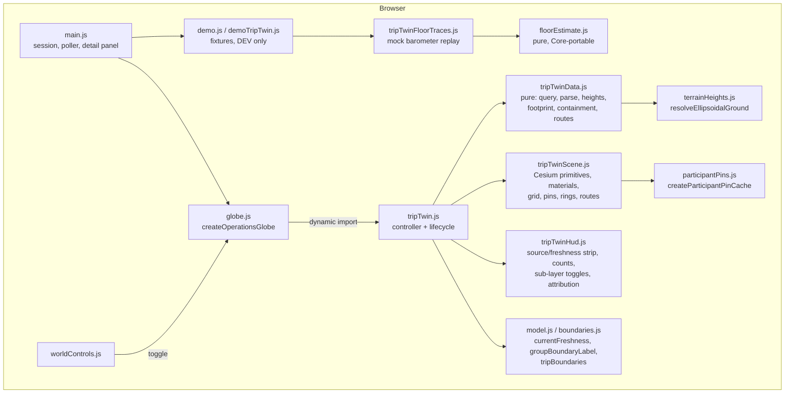
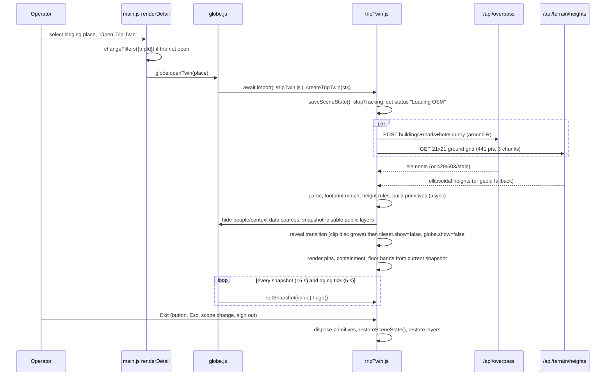
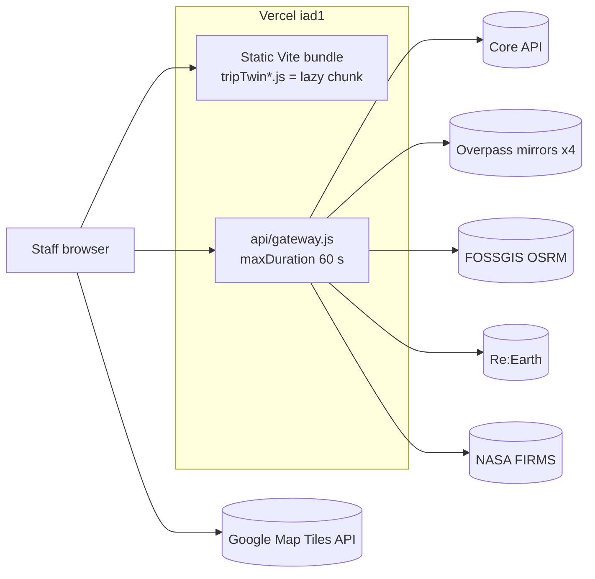

# 03 — Trip Twin architecture (CTA)

Owner: Chief Technology Architect. Status: proposed for the prototype PR to Justin. Date: 2026-10-15.
Companion file: `07-production-delta.md` (field-by-field mock-to-production contract).

Repos read (read-only):
- `gods-eye-view` on `jesse/world-view-visual-layer` (HEAD `d59ca04`)
- `safetrekr-core` on `develop` (HEAD `d6e7001`), plus Justin's unmerged `origin/stopped-phone-staff-ops`
- `mobile-app` on `develop`
- `safetrekr-app-v2` on `develop`

Every assumption is marked **ASSUMPTION A-n** and listed again in section 17.

---

## 0. Decisions in one page

| # | Decision | Section / ADR |
|---|---|---|
| 1 | The prototype changes **only gods-eye-view** and runs on **mock data** using Justin's demo pattern (`src/operations/demo.js`). The mobile and Core work is the next phase, gated on the prototype's results. | 2, 6, 11 |
| 2 | The hologram is built in the browser from **OpenStreetMap buildings** fetched through the existing `/api/overpass` proxy. It is drawn as Cesium `Primitive` batches with a custom translucent fresnel appearance. It is not built from Google meshes. It is not a glTF or 3D Tiles bundle in P0. | 4, ADR-001 |
| 3 | "Solo" sets the Google tileset and the globe to `show = false`, saves and restores their state exactly, and re-applies it if the map stack changes. Google tiles are never restyled or recolored. `ClippingPolygonCollection` is used only for the reveal transition. | 4.7, ADR-002 |
| 4 | All twin geometry (buildings, grid, pins, rings, routes, fires) sits on **one heightfield** sampled from the existing keyless `/api/terrain/heights` proxy (Re:Earth). Nothing uses `CLAMP_TO_GROUND`, because no surface is left to clamp to once the city is hidden. Nothing derives heights from Google tiles. | 4.4, ADR-003 |
| 5 | Traveler positions are mandatory P0. "Inside or outside the hotel" is a three-state answer computed in the browser from the OSM footprint, the reported fix and its accuracy radius. "Outside the group zone" comes **only** from Core's `group_zone_state`. | 7.1, ADR-004 |
| 6 | Floor estimates are drawn as **bands with an age and a confidence**, never as a bare number or a room. In the prototype the estimate comes from a pure, deterministic module that replays mock barometer traces. That module stands in for Core and never runs in the rendering path. | 6.4, 7.2, ADR-006 |
| 7 | New code lives in `src/operations/tripTwin*.js`, loaded only by dynamic `import()`. It is off by default and behind a build flag. It plugs into the existing code at six small points in `globe.js`, `main.js` and `worldControls.js`. | 5, ADR-005 |

Feasibility verdicts (detail in section 14):

| Phase | Scope | Verdict |
|---|---|---|
| P0 | Hologram, hotel, traveler positions, containment, floor bands from mock traces, three cities | **Feasible**. About 8-12 engineer-days. The main risks are external: Overpass capacity, and how good the look is with Primitive materials (a 1-day spike). |
| P1 | Safety-point rings, OSRM routes with an alternate, live FIRMS fires, rim indicators | **Feasible**. About 5-8 days. It needs one additive server change (`alternatives` on `/api/route`) and one additive hook in `firmsHeatmap.js`. |
| P2 | Indoor data, hero glTF models, SOC wall | **Hero models are feasible** (the repo already loads `.glb`). **Indoor routing is not feasible** without a new floor-plan source. The SOC wall needs a performance pass. |
| Next phase | Real barometer capture (mobile) and floor calibration and exposure (Core) | **Feasible with field validation.** Accuracy is unproven until a real-building test. See 11.6. |

---

## 1. Facts I checked in the code

| Fact | Where | Consequence for Trip Twin |
|---|---|---|
| Cesium is **1.138.0** in the lockfile. `package.json` declares `^1.124.0`. | `package-lock.json` (`node_modules/cesium`), `package.json` | Available: `ClippingPolygonCollection` (1.117), `CustomShader` (Model and tileset only), `PostProcessStageLibrary`, `EXT_mesh_primitive_edge_visibility` (1.135), `scene.pickAsync` (1.136). From 1.140, billboards and labels need WebGL 2, and the caret range would allow that version. See R-08. |
| World View runs at `viewer.targetFrameRate = 30`, always in the continuous loop. | `src/operations/globe.js` `createOperationsGlobe` (line 55) | The perf budget is 30 fps. |
| The idle **render governor is not installed in World View.** `installRenderGovernor` is called only from `src/standalone/tools.js` `createStandaloneTools`. The page entry is `/src/operations/main.js` (`index.html` line 927), which never calls it. | `src/renderGovernor.js`, `src/standalone/tools.js:39` | `holdContinuousRender` and `governorRequestRender` are no-ops in World View today. The twin calls them anyway (5.5), so it stays correct if the governor is installed later. |
| Google tiles hide the globe. `MapStackController` toggles `googleTileset.show` and `scene.globe.show` per stack and broadcasts `gev:map-stack-changed`. | `src/standalone/scene.js` `createStandaloneScene` (line 65), `src/mapStackController.js` `_activatePhotoreal` / `_activateGlobeStack` (lines 282-315) | Solo must save and restore both flags, and must re-assert itself when the operator changes the basemap. |
| Trip markers, pins and boundaries use `CLAMP_TO_GROUND` and `classificationType: BOTH`. | `globe.js` `label`, `pointStyle`, `renderPeople`, `renderBoundary` | With the tiles and the globe hidden, these have nothing to clamp to or classify onto, and they would disappear or float at ellipsoid height. The twin hides those two data sources and redraws on its own heightfield. |
| `/api/overpass` is **POST only** and sanitized: `around` ≤ 50 km, bbox ≤ 12°, no `foreach/complete/retro/compare/convert/make/poly`, `[timeout]` clamped to 30 s, body ≤ 24 KB. It allows 90 req/min per client and 300 globally, 6 concurrent upstream fetches (otherwise 503 with Retry-After 2), a 24 h memory cache of 120 entries, a 7-day disk cache in `.gev-cache/overpass`, serve-stale fallback, and 4 mirrors at 22 s timeout each. Server-side simplification applies only to bodies ≥ 1.5 MB, and only to elements with ≥ 1,200 points. | `server/providers/local.js` `overpassProxy`, `sanitizeOverpassBody`, `simplifyOverpassPayloadBody`, `OVERPASS_*` constants | Building footprints pass through unsimplified. The query must be bounded by `around`. |
| `/api/route` is GET, profile `foot|car|bike`, 2-12 coordinates, legs ≤ 600 km, a 10 min / 200-entry cache, 60 req/min per client and 200 globally, upstream `routing.openstreetmap.de` (FOSSGIS), 12 s timeout, **`alternatives=false` hard-coded**. A failure returns HTTP 200 `{ok:false,error}`. | `server/providers/places/routes.js` `installRouteMiddleware` | A primary route works today. An alternate needs an additive param (7.4). |
| `/api/route` is mounted by `overpassProxy().configureServer`, so it is live **both** in Vite dev and on Vercel. | `server/providers/local.js` line 1425, `api/gateway.js` `registeredRoutes` | No gateway change is needed. |
| The Vercel gateway allows POST only for `/api/overpass` and `/api/terrain/heights`. Every provider route needs the `__Host-safetrekr-world` cookie (TTL 300 s), which is issued when Core authorizes the operations call. | `api/gateway.js` `handler`, `server/standalone/providerSession.js` | Twin requests ride the existing session. Snapshot polling every 15 s keeps the cookie alive. |
| `vercel.json` sets `maxDuration: 60` for `api/gateway.js`. The Overpass disk cache writes to `process.cwd()/.gev-cache`. | `vercel.json`, `local.js` `OVERPASS_DISK_DIR` | On Vercel the disk cache is not writable and the memory cache is per instance. Four mirrors at 22 s can exceed 60 s. See R-01. |
| `/api/terrain/heights?points=lon,lat;…` takes up to 2,000 points and returns **ellipsoidal** heights from Re:Earth (CC BY 4.0), with a 30-day disk cache. The client `resolveEllipsoidalGround(coords)` sends sequential chunks of 200 and falls back per chunk to EGM96 geoid math. | `server/providers/terrain.js`, `src/data/terrainHeights.js` `resolveEllipsoidalGround` (line 163) | This is the twin's height source. It has no key and a built-in fallback. |
| The existing height rule is `height` or `building:height` (m or ft), else `building:levels × 3.3 + roof:height`, else a size-based guess clamped to 10-70 m. | `src/annotations/annotationResolver.js` `buildingHeightFromTags`, `parseMeters` (module-private) | The twin uses the same 3.3 m/level constant. It replaces the size-based guess with a fixed default that is visibly marked approximate (4.3). |
| The single-building highlight is an extruded classification volume with a 1 px polygon outline cage, a dashed outline for synthesized areas, and a flowing route fabric `GevRouteFlow`. | `src/annotations/worldAnnotationRenderer.js` `add`, `makeRouteFlowMaterial`, `ensureFlowFabricRegistered` (module-private) | The visual patterns are reused. Classification is useless once the tiles are hidden. Polygon `outlineWidth` > 1 is not honored on Windows/ANGLE, so the hotel's glowing edges must be polylines. |
| FIRMS records come from `fires.getAnalystRecords(max)` (sorted by FRP) as `{id, lat, lon, frp, confidence, satellite, acqTime}`. It returns `[]` when the layer is disabled. The client refreshes every 10 min and the proxy has a 30 min TTL. | `src/data/firmsHeatmap.js` `mapAnalystRecord`, `getAnalystRecords`, `REFRESH_INTERVAL_MS` | The fire layer reads the in-memory records with no extra request. FIRMS's own sprites clamp to the ground, which is wrong in solo mode (7.5). |
| The demo is development-only. `?demo=1` or the "Explore a sample trip" button calls `demoSnapshot()`, which `SnapshotPoller` regenerates on every 15 s poll. | `src/operations/main.js` `openSession`, `poller`; `src/operations/demo.js` | The Trip Twin fixture follows this pattern (section 6). |
| Participant wire fields: `coordinates`, `accuracy_m`, `capturedAt`, `locationAgeSeconds`, `isFresh`, `freshness`, `freshMaxAgeSeconds`, `staleAgeSeconds`, `avatar_url`, `role`, `group_zone_state` (+ `group_zone_ambiguous`). The presence fields `presence`, `stationarySince`, `lastContactAt` exist **only on `origin/stopped-phone-staff-ops`**, not on `develop`. | `safetrekr-core/src/services/staff_operations.py` `_person`, `location_freshness.py` `to_payload` | The fixture uses exactly these names. See `07-production-delta.md`. |
| The snapshot exposes no altitude. `participant_locations` is one upserted row per (trip, user) and is **in the `supabase_realtime` publication**, so every column reaches subscribed phones. | `staff_operations.py` `LOCATION_COLUMNS`; `supabase/migrations/20261013170000_participant_locations_stationary.sql` header | Production floor data must **not** go into `participant_locations` (11.3). |
| Package boundaries cover only exported entry points. `src/operations/*` is in no group. `routes.js` is in `place-providers`. | `scripts/package-boundaries.json`, `scripts/check-package-boundaries.mjs` | New twin modules need no boundary edit. The `routes.js` change must not add imports from outside that group. |

---

## 2. Scope: prototype now, production next

| | Prototype (this PR, gods-eye-view only) | Production path (next phase, not built now) |
|---|---|---|
| Traveler data | `demoTripTwin.js` fixture in snapshot shape, fictional people, scripted timeline | Existing Core snapshot (`participants`, `group_zones`, `geofences`, `geofence_events`) |
| Floor estimate | Mock barometer traces replayed by `tripTwinFloorTraces.js` → `floorEstimate.js` (pure) → `participant.floor_estimate` | Mobile captures pressure. Core anchors, calibrates and computes `floor_estimate` and exposes it in the snapshot |
| Hotel, buildings, roads | **Real** OSM through `/api/overpass`, with recorded fixtures for offline QA | Same |
| Ground heights | **Real** Re:Earth through `/api/terrain/heights` | Same |
| Routes, fires | P1: **real** OSRM and FIRMS, plus a flagged simulated fire scenario so the demo has something to show | Same, plus self-hosted fallbacks if usage grows (R-01, R-03) |
| Repos touched | gods-eye-view | mobile-app, safetrekr-core, optionally safetrekr-app-v2 (lodging metadata entry) |

The prototype is designed so that switching from mock to production means **swapping the snapshot source**. No renderer change is needed. The floor estimator is only ever called by the fixture, never by the twin.

---

## 3. Diagrams

### 3.1 System context



### 3.2 Container view (prototype)



### 3.3 Enter the twin (sequence)



### 3.4 Data-access flow (no new auth path)

```mermaid
sequenceDiagram
  participant B as Browser (staff)
  participant S as Supabase Auth
  participant GW as api/gateway.js
  participant C as Core /operations
  B->>S: signInWithPassword (+TOTP when aal2 required)
  S-->>B: session (sessionStorage)
  B->>GW: GET /api/safetrekr/operations?trip_id=… (Bearer)
  GW->>C: staffCoreProxy forwards; Core verifies role + org scope
  C-->>GW: snapshot (participants, places, safety_points, group_zones…)
  GW-->>B: snapshot + Set-Cookie __Host-safetrekr-world (300 s HMAC)
  B->>GW: POST /api/overpass, GET /api/route, GET /api/terrain/heights (cookie)
  GW->>GW: validProviderSession() else 401
  Note over B,GW: Trip Twin adds no endpoint, no token type, no Core call.<br/>DEV demo mode never calls Core.
```

### 3.5 Deployment topology



---

## 4. Building the hologram from OSM in CesiumJS

### 4.1 Query strategy

- **Center:** the lodging `place.coordinates` from the snapshot. It is rounded to 5 decimal places so cache keys are stable per hotel.
- **Radius R:** default **400 m** (about a 5-minute walk). The operator can choose 250 / 400 / 600 m. The maximum is 800 m, to stay under the primitive budget (section 8). ASSUMPTION A-1: 400 m covers the blocks that matter for an evacuation decision. The rim indicators in 7.3 cover anything further out.
- **One Overpass request per twin.** It returns buildings, a little hotel detail, entrances and streets:

```
[out:json][timeout:25];
(
  way(around:R,LAT,LON)["building"];
  relation(around:R,LAT,LON)["building"]["type"="multipolygon"];
  way(around:150,LAT,LON)["building:part"];
  nwr(around:150,LAT,LON)["tourism"~"^(hotel|hostel|guest_house|motel|apartment)$"];
  node(around:150,LAT,LON)["entrance"];
  way(around:R,LAT,LON)["highway"~"^(motorway|trunk|primary|secondary|tertiary|unclassified|residential|living_street|pedestrian|service|footway|steps)$"];
);
out geom qt;
```

  Every statement is bounded by `around`, so it passes `sanitizeOverpassBody`. `out geom` returns relation member geometry for courtyard multipolygons. `building:part` is limited to 150 m (the hero building's setbacks) to keep the payload small.
- **Measured coverage (live Overpass, 2026-10-15, 400 m, tag counts):**

| City / hotel | Hotel OSM element | Buildings in 400 m | With `height` or `building:levels` | Notes |
|---|---|---|---|---|
| Austin, TX: Fairmont Austin | way 134786106, `building:levels=37` | 173 | 58% | Tall; good for floor bands. Hilton Austin nearby is node-only, which is a good footprint-matching test. |
| Washington, DC (Capitol Hill): Hilton Washington DC Capitol Hill | way 48040879, `height=50.75`, `building:levels=14` | 80 | 54% | Height-tagged; tests the measured-height path. |
| London (South Bank): Park Plaza London Waterloo | way 491692833, no height or levels | 201 | 29% (485 `building:part`) | Tests the default-height path, `building:part`, and ground-floor-0 numbering. |

  Also observed today: overpass-api.de answered "502, at capacity" on the first try, and two mirrors returned HTTP 500. This is evidence for R-01.
- **Client wrapper:** `tripTwinData.overpassRequest(query, {signal, timeoutMs: 25000})`. It mirrors the semantics of `annotationResolver.overpassJson`, which is module-private and so cannot be imported: 429, or 503 with `Retry-After`, becomes `{rateLimited, retryAfterMs}`. The response header `X-Overpass-Cache: STALE` is surfaced as "OSM data from cache" in the source strip.
- **Session cache:** a `Map` keyed by `placeId|R|queryVersion` holding parsed buildings for the browser session. It is cleared on scope change or sign-out. **Nothing is persisted.**
- **Prefetch:** none in P0. ASSUMPTION A-2: operators accept up to about 12 s for a cold first load. The `X-Overpass-Cache` HIT/DISK path makes reopening near-instant locally. On Vercel this is not guaranteed (R-01).

### 4.2 Geometry approach

| Option | Pros | Cons | Verdict |
|---|---|---|---|
| A. Entity `PolygonGraphics` with `extrudedHeight` per building | Simplest, and like the existing renderer | One entity per building means heavy Entity → Primitive churn. Outline width is fixed at 1 px. Little shader control. | Rejected except for the < 20 overlay entities |
| **B. `Primitive` + `GeometryInstance` batches** (extruded `PolygonGeometry`, holes for courtyards), `asynchronous: true` (worker triangulation), with a custom translucent appearance | 1-3 draw calls for all buildings. Per-instance id for picking. Per-instance color/show for hotel, normal and approximate. Order-independent translucency is on by default. | Fresnel needs a custom `Appearance` or Material fabric (spike S-1). `CustomShader` does not apply to `Primitive`. | **Chosen for P0/P1** |
| C. Client-built GLB through `Model.fromGltfAsync({gltf: Uint8Array})` with `CustomShader` and `EXT_mesh_primitive_edge_visibility` | Full shader control, native edges, silhouettes | You must write a GLB writer plus metadata. The edge extension is new (1.135). More code to review. | Fallback if B cannot reach the look. Used in P2 for hero models. |
| D. 3D Tiles generated in the client | No benefit for one area | Complexity | Rejected |

Batches in B:

| Primitive | Content | Appearance |
|---|---|---|
| `twin.buildings.mapped` | Buildings whose height came from a tag or from levels | Translucent glass with fresnel rim (4.5) |
| `twin.buildings.approximate` | Buildings with a default height | Same glass with lower alpha, and no roof edge |
| `twin.hotel` | The selected hotel footprint (+ its `building:part`s) | Glass in the "ours" tint, plus floor slabs (7.2) |
| `twin.edges` | `PolygonOutlineGeometry` (extruded) for mapped buildings | 1 px lines, slate-teal |
| `twin.hotelEdges` | `PolylineCollection`: roof ring + vertical corner edges of the hotel, width 2-3 px | `PolylineGlow`. **Dashed** if the hotel footprint or height is approximate |
| `twin.roads` | `PolylineCollection` laid on the heightfield + 0.3 m | Thin, low-contrast |
| `twin.grid` | One `EllipseGeometry` disc of radius R + 100 m, draped on the heightfield (4.6) | Grid fabric |

Pick ids are objects `{ opsRecord: { kind: 'twin-building', record } }`, so the existing `globe.js` click handler (`pick.id?.opsRecord`) routes them with no change (hook H-5 handles the unknown kind).

### 4.3 Height fallback rules (pure, `tripTwinData.buildingHeight(tags, areaM2)`)

| Order | Rule | `heightSource` | Drawn as |
|---|---|---|---|
| 1 | `height` or `building:height`, parsed in m or ft (same parser as `annotationResolver.parseMeters`) | `measured` | Solid |
| 2 | `building:levels × 3.3 + roof:height` (or `roof:levels × 3.3 × 0.5`) | `levels` | Solid |
| 3 | `min_height` / `building:min_level` for parts (base offset) | as above | as above |
| 4 | Type default: `house/detached/semidetached_house/bungalow` 6.6 m, `garage/shed/kiosk/roof/carport` 3 m, everything else **9.9 m** (3 levels) | `default` | **Approximate**: lower alpha, dashed if it is the hotel, "Height not mapped" on hover/detail |
| — | Footprints < 15 m² or > 400,000 m² are skipped (same band as `selectFootprint`) | — | — |

The 3.3 m/level constant matches `buildingHeightFromTags`. The resolver's size-based guess (10-70 m) is **not** reused, because a guessed 70 m tower misleads an operator more than a visibly flagged 9.9 m block. ASSUMPTION A-3: the floor-height default is 3.3 m. Hotels commonly run 3.0-3.5 m, with lobbies of 4-6 m.

**Hotel footprint selection** (`selectHotelFootprint`), in order:
1. A building polygon containing the lodging point.
2. A building tagged `tourism=hotel`, or containing a `tourism=hotel` node, whose name overlaps the lodging name, within 120 m.
3. The nearest building within 40 m with area ≥ 150 m².
4. Otherwise a **30 m synthesized circle**, flagged `approximate`. Containment is then switched off and labeled "Hotel footprint not mapped; inside/outside not assessed".

The match basis is shown in the source strip ("Footprint: OSM way 134786106, contains hotel point").

### 4.4 Ground: one twin heightfield

- Sample a **21 × 21 grid** (441 points, 60 m spacing over a 1.2 km square for R = 400 m) through `resolveEllipsoidalGround`. That is 3 sequential chunks of 200, cached 30 days on the server. The grid is extended by the R → 2R rim used for safety and fire indicators.
- `heightAt(lat, lon)` interpolates bilinearly. Each building's base = `min(heightAt(vertex))` over its ring, so slopes never leave a building floating. The grid disc is built as a mesh from the same samples, so pins, rings, routes and buildings share one ground.
- **Failure:** the per-chunk geoid fallback in `resolveEllipsoidalGround` returns geoid-corrected sea level. The twin then shows "Ground elevation: approximate (terrain service unavailable)". Buildings stay correct relative to each other.
- **No Google-derived heights.** The Map Tiles policy forbids non-visualization use and data "derived by hand or machine" from Photorealistic 3D Tiles, and the tiles are hidden in solo anyway. `worldAnnotationRenderer.sampleGroundOutside` (which samples the tiles) is deliberately not reused.

### 4.5 Materials (parameters; colors come from SafeTrekr brand tokens)

Colors follow "COLOR AND BRAND" in `00-CONTEXT.md`. The tokens below come from `safetrekr-app-v2` dark theme and brand ramps. Final values belong to the design wave (`04-screen-spec.md`). Each color carries **one meaning**:

| Proposed token | Value (derived from) | Meaning |
|---|---|---|
| `twin-field` | `#061a23` (background) | Scene background in solo |
| `twin-glass` | `#415e6b` at α 0.10-0.16 (slate-teal ramp) | Other buildings |
| `twin-glass-approx` | `#415e6b` at α 0.06 | Height not mapped |
| `twin-edge` | `#80959b` at α 0.45 | Mapped building edges |
| `twin-ours` | `#4ba467` glass α 0.18, edges `#81bf95` | **The trip's hotel** (ours) |
| `twin-grid-minor` / `twin-grid-major` | `#1e404f` / `#2a4a59` | Ground grid |
| `twin-safe` | `#4ba467` / `#c9e4d1` label | Safety resources (with an icon per category) |
| `twin-hazard` | `#ee7789` (destructive, dark) | Fire detections, incident floor |
| `twin-warn` | `#f59e0b` | Aging data, approximate containment |
| People | Existing `PEOPLE_COLORS` in `model.js` (traveler `#71cc9a`, chaperone `#75b9f2`, aging `#e6bb66`, stale `#d98585`) | Must match the World View legend (`main.js` `.ops-legend`) |

Never color alone: each state also changes shape (solid/dashed/hollow), icon and label.

Shader parameters (custom `Appearance` derived from the `PerInstanceColorAppearance` shaders, or a Material fabric per batch; decided by spike S-1):
- `fresnelPower` 2.0-3.0. Rim alpha = `baseAlpha + rimAlpha × (1 − |dot(n̂, v̂)|)^power`, with `normalEC` and `positionToEyeEC`.
- `heightRamp`: world position comes from `czm_inverseView × (−positionToEyeEC)`. Brightness rises slightly toward the roof, which reads as volume.
- `scanSpeed` (0 when `prefers-reduced-motion`): one faint horizontal band sweeping up every 6 s. It has exactly one meaning, "the traveler snapshot feed is live". It stops when the snapshot is older than 45 s (the `main.js` `updateSync` threshold) or the feed is interrupted. OSM age does not drive it, because building data is static.
- **Not used in P0:** `PostProcessStageLibrary.createBloomStage` (full-screen cost at 4K; revisit for the wall) and edge-detection stages (they would also outline labels and billboards).

### 4.6 Grid ground plane

A single draped disc mesh (4.4) with a fabric that draws minor lines every 10 m and major lines every 50 m, using `fract()` on local ENU meters passed as a uniform origin. It fades radially to `twin-field` at R + 100 m. Its purpose is scale and distance reading ("the rally point is 3 major squares away"). The 50 m major spacing is printed in the HUD scale note.

### 4.7 Soloing the area

| Technique (Cesium 1.138) | Allowed by Google terms? | Use |
|---|---|---|
| `googleTileset.show = false`, `scene.globe.show = false` | Yes. Nothing is shown, so nothing needs attribution, and Cesium drops Google credits for hidden tiles. | **Steady-state solo** |
| `ClippingPolygonCollection` on the Google tileset (inside a growing disc) | Yes in practice. Cesium documents clipping Google tiles to insert your own model. Our overlay is OSM, not derived from Google. Data from Google must stay labeled. | **Reveal transition only**: the city "falls away" inside the disc for about 1.2 s, then `show=false`. Gate with `ClippingPolygonCollection.isSupported(scene)`. ASSUMPTION A-4: this requires WebGL 2 in 1.138. On failure, cross-fade instead. |
| Optional "context ring": photoreal kept **outside** the twin disc (inverse clip) | Yes, same reasoning. The UI must say which part is Google. | Operator toggle, P1, off by default. Costs Google GPU and requests. |
| `CustomShader` / `style` on the Google tileset (dim or tint) | **Unclear.** The policy does not explicitly forbid it, but it is close to "modifying content". Google tiles have no per-feature batch table anyway. | **Not used** |
| Full-scene `PostProcessStage` vignette | Precedent exists (`visualModes.js` night vision etc.) | Not needed, since solo hides the tiles |

`saveSceneState()` records, and `restoreSceneState()` puts back exactly:
- `tileset.show`, `globe.show`
- `skyAtmosphere.show`, `skyBox.show`, `sun.show`, `moon.show`, `fog.enabled`
- `backgroundColor`
- `screenSpaceCameraController` settings it changes
- the camera transform (`lookAtTransform(Matrix4.IDENTITY)` on exit)
- the active visual mode (`globe.visualModes.active`; the twin sets `'normal'` on entry)
- the set of enabled public layers (`manager.getEnabledLayerIds()` → restored with `manager.restoreEnabledLayerIds(ids, {origin:'programmatic'})`)

While the twin is active, a `gev:map-stack-changed` listener refreshes the saved `tileset.show` / `globe.show` from the new stack, then re-asserts `false`. Exiting therefore lands on whatever basemap the operator chose last.

Camera: orbit around the hotel with `camera.lookAtTransform(ENU(hotel), HeadingPitchRange)`. A `camera.changed` guard keeps the eye ≥ ground + 15 m, because collision detection relies on a globe or tiles that are now hidden.

### 4.8 Attribution inside the twin

The HUD source strip always shows "Buildings & streets © OpenStreetMap contributors (ODbL)", plus the terrain credit "Re:Earth / Mapterhorn (CC BY 4.0)", and while routes are drawn "Routing: OSRM / FOSSGIS". This is visible on screen, not only in the popover registered by `registerDataCredits`. When the context ring shows Google tiles, the Google logo and credits stay visible (existing `#cesium-credits` container), and the ring is labeled "Photorealistic surroundings: Google".

---

## 5. Where the code lives

### 5.1 New files (all under `gods-eye-view`)

| File | Responsibility | Imports |
|---|---|---|
| `src/operations/tripTwin.js` | Controller: `createTripTwin({viewer, Cesium, manager, mapStack, visualModes, pinCache, people, context, fires, onSelect, signal})` → `{ open(place, snapshot), close(), setSnapshot(s), age(elapsed), heightAt(), frame(), select(record), isActive, dispose() }`. Lifecycle, state save/restore, status machine `idle → loading → ready → degraded → closing`. | `cesium`, `./tripTwinData.js`, `./tripTwinScene.js`, `./tripTwinHud.js`, `./model.js`, `./boundaries.js`, `../data/terrainHeights.js`, `../renderGovernor.js` |
| `src/operations/tripTwinData.js` | **Pure, no Cesium/DOM**: `buildTwinQuery`, `parseOverpassBuildings`, `buildingHeight`, `selectHotelFootprint`, `gridPoints` / `makeHeightfield`, `hotelContainment`, `selectTwinSafetyPoints`, `rimIndicators`, `routeRequest` / `parseRoute`, `routeHazardProximity`, `firesNear`, `ringStitch` (own copy; resolver's `stitchRing` is private) | `./model.js`, `./boundaries.js` |
| `src/operations/tripTwinScene.js` | Cesium construction and teardown of all primitives, materials, polylines, billboards. Owns `TWIN_PALETTE` (4.5). Pick-id wiring. | `cesium`, `./participantPins.js` |
| `src/operations/tripTwinHud.js` | DOM chrome inside `#ops-console`: source/freshness strip, inside/outside/uncertain counts, floor-incident input, sub-layer toggles, exit button, attribution, `aria-live` status. Exact layout comes from `04-screen-spec.md`. | none |
| `src/operations/floorEstimate.js` | **Pure, portable** floor estimator (6.4). Used only by the fixture in the prototype. | none |
| `src/operations/demoTripTwin.js` | DEV-only fixture: `tripTwinDemoSnapshot(cityKey)` in exact snapshot shape (6.1) | `./floorEstimate.js`, `./tripTwinFloorTraces.js` |
| `src/operations/tripTwinFloorTraces.js` | Seeded mock barometer traces (6.3) | none |
| `src/operations/tripTwin.css` (or a section in `operations.css`) | HUD styles with brand tokens | — |
| Tests: `src/operations/tripTwinData.test.mjs`, `floorEstimate.test.mjs`, `tripTwinLifecycle.test.mjs`, `demoTripTwin.test.mjs` | Section 15 | `node:test` |
| QA: `scripts/qa-trip-twin.mjs`; fixtures `scripts/fixtures/trip-twin/{austin,dc,london}.overpass.json`, `floor-vectors.json` | Browser verification and golden vectors | puppeteer (existing devDependency) |

`src/operations/*` belongs to no boundary group, so `scripts/package-boundaries.json` is unchanged. None of these files imports `node:*` (`src/browserModuleBoundary.test.mjs` stays green). `tripTwinData.js` and `floorEstimate.js` avoid `cesium`, so they run under `node --test`.

### 5.2 Hook points in existing files (minimal)

| ID | File / function | Change | Size |
|---|---|---|---|
| H-1 | `src/operations/globe.js` `createOperationsGlobe`, returned object | Add `openTwin(place)`, `closeTwin()`, `get twinActive()`. `openTwin` does `await import('./tripTwin.js')` (separate Vite chunk; zero bytes loaded when unused) and passes the closure's `viewer`, `manager`, `scene.mapStackController`, `visualModes`, `pinCache`, `people`, `context`, `fires`, `onSelect`, `signal`. Push `() => twin?.dispose()` onto `cleanups` (runs before the viewer is destroyed, because cleanups run in reverse). | ~35 lines |
| H-2 | `globe.js` `setSnapshot(value)` and the `agingTimer` `setInterval` | Forward `twin?.setSnapshot(value)` and `twin?.age()`. | 2 lines |
| H-3 | `globe.js` `focus(point, range)`, `frameTrip(tripId)`, `resetView()`, `follow(person)` | While the twin is active: `focus` uses `twin.heightAt` instead of the fixed 2 m in `position()`; `frameTrip` → `twin.frame()`; `resetView` closes the twin first; `follow` is disabled (the twin has its own "pin selected" highlight). | ~10 lines |
| H-4 | `src/operations/main.js` `renderDetail()`, branch for `kind === 'place'` with `record.kind === 'lodging'` and `validPoint(record.coordinates)` | Add the "Open Trip Twin" button behind `import.meta.env.VITE_TRIP_TWIN === '1'`. On click: if `filters.tripId !== record.trip_id`, `changeFilters({tripId})`; then `globe.openTwin(record)`. | ~15 lines |
| H-5 | `main.js` `lockView()`, `changeFilters()`, `acceptSnapshot()` | `globe?.closeTwin()` in `lockView` and `changeFilters` (a scope change must never leave the old trip's hologram or people on screen). In `acceptSnapshot`, a `selected.kind` starting with `twin-` keeps the selection rather than looking up a missing collection. | ~6 lines |
| H-6 | `main.js` `openSession` / `poller.request` and the demo button block | Add a DEV-only second entry, "Explore Trip Twin sample", and `?demo=twin&city=austin|dc|london`. `demo` becomes `false | 'trip' | 'twin'` (truthiness is unchanged). The `request` branch calls `tripTwinDemoSnapshot(city)` for `'twin'`. | ~15 lines |
| H-7 | `src/operations/worldControls.js` `mountWorldControls`, `PRIVATE_LAYERS` block | One extra row, "Trip Twin (hotel hologram)", **unchecked by default**, disabled until a trip with a lodging is open. Checking it opens the twin for the selected (or first) lodging; unchecking closes it. The `keydown` digit shortcuts for visual modes are ignored while `globe.twinActive`. | ~20 lines |
| H-8 (P1) | `src/data/firmsHeatmap.js` `createFirmsHeatmapLayer` return object | Additive `setPresentationSuppressed(flag)`: `_dataSource.show = !flag` and `overlayHost.setVisible(FIRMS_OVERLAY_SOURCE_ID, _enabled && !flag)`. Lets fire data stay loaded while its ground-clamped sprites are hidden in solo. | ~10 lines |
| H-9 (P1) | `server/providers/places/routes.js` `installRouteMiddleware` | Additive `alternatives=1` query param → upstream `alternatives=true`, response gains `alternatives: [projectRouteResult(r)]`. Add it to the cache key. Default behavior is byte-identical when absent. No new imports (boundary-safe). | ~15 lines |

### 5.3 Off by default, and what "off" means

- Without `VITE_TRIP_TWIN=1`, no button and no layer row is rendered, and `tripTwin*.js` is never fetched. Existing users see no change. A smoke test asserts that no `tripTwin` chunk is requested (15.2).
- With the flag on, the twin is still closed until an operator opens it, and no scene state is touched until `open()`.

### 5.4 Clean disposal (`tripTwin.close()` / `dispose()`, idempotent)

1. Abort the twin's `AbortController` (in-flight Overpass, terrain and route fetches).
2. `releaseContinuousRender('trip-twin-motion')`.
3. Remove primitives, `PolylineCollection`s, the twin `CustomDataSource`, `preRender` / `camera.changed` / `gev:map-stack-changed` listeners, and HUD DOM; destroy materials.
4. `restoreSceneState()` (4.7), including `manager.restoreEnabledLayerIds(saved, {origin:'programmatic'})` and the visual mode.
5. `people.show = true; context.show = true`; then call the globe's existing `renderPeople()` / `renderContext()` so the photoreal markers are current.
6. Clear the session cache only on `dispose()` (scope change or sign-out), not on `close()`.

A lifecycle unit test asserts every `add` has a matching `remove` and that the scene flags are equal before and after (15.1).

### 5.5 Render governor interaction

- Today: World View renders continuously at 30 fps. The twin adds no loop of its own.
- Future-proofing: call `holdContinuousRender('trip-twin-motion')` only while a transition, scan sweep or route flow is animating. Release on settle, on `prefers-reduced-motion`, or on close. Call `governorRequestRender('trip-twin')` after each discrete mutation (snapshot applied, layer toggled). These calls are no-ops until someone installs the governor in World View.

---

## 6. Prototype data (mock only, gods-eye-view only)

### 6.1 Fixture: `tripTwinDemoSnapshot(cityKey)`

- It returns **the same envelope as `demoSnapshot()`** and as Core's v1 snapshot: `schema_version, generated_at, scope, capabilities, page, source_issues, trips, participants, places, itinerary, safety_points, geofences, geofence_events, group_zones, musters, morning_musters, alerts, flights`.
- The file header says what `demo.js` says: "Development-only fictional fixtures. Never fetched from production." People are fictional. Hotel names and coordinates are real public places (needed for real OSM). Every on-screen badge reads `SIMULATED DATA · SAMPLE TRIP` (existing `ops-environment` text).
- Field names match today's wire names exactly. New fields use the production names proposed in `07-production-delta.md`, so nothing is renamed later:
  - `participants[].floor_estimate` (object, snake_case keys; 6.4)
  - `places[].participant_ids` (assigned guests; same name as `flights[].participant_ids`)
  - `places[].levels_above_ground`, `places[].ground_floor_label` (nullable; analyst override of OSM)
  - `geofences[].source_id` (links the lodging safe-zone geofence to its place)
  - the presence trio `presence`, `stationarySince`, `lastContactAt` (from Justin's branch)
- **Scripted timeline:** `const scenarioStart = Date.now()` at module load (the same idea as `demoFlightStart`). Ages and positions are functions of `now − scenarioStart`, so freshness changes across polls. This differs from `demoSnapshot()`, whose ages are frozen.
- **People per city (14 each)**, covering every state the overlay must draw:

| Case | Example | Expected twin answer |
|---|---|---|
| Fresh, inside footprint, good accuracy (8-15 m) | 4 travelers in hotel | Inside; floor band shown |
| Fresh, inside footprint, poor accuracy (45-65 m, typical indoors) | 2 | Uncertain (fix inside, radius crosses the footprint edge) |
| Fresh, on the street 30-120 m away | 2 | Outside hotel, inside group zone |
| Fresh, 600 m away | 1 | Outside hotel, **outside group zone** (`group_zone_state: 'outside'`) |
| Stopped but current (`presence: 'stopped'`, old fix, recent contact) | 2 | "At this location for 2h 10m", treated as current |
| Stopped, did not answer (`stopped_no_answer`) | 1 | Last known, not current |
| Aging / stale moving fix | 1 / 1 | Aging (amber) / Last known (red, hollow) |
| No location (`coordinates: null`) | 1 | Listed in the HUD "No location" count, not drawn |
| Chaperone (fresh) | 1 | Chaperone pin (counted in the 14) |
| One traveler walks out of the hotel to the street over 3 minutes | scripted | Inside → uncertain → outside as the poll updates |

- `group_zones`: a `nearest_chaperone` zone centered on the chaperone, radius 400 m, `valid_for_seconds: 45`. `group_zone_state` per person is computed **by the fixture generator** with the same point-in-circle test Core uses. The twin reads the field and never recomputes it. A test asserts the fixture is self-consistent (15.1).
- `geofences`: the lodging safe zone, `type: 'circle'`, `radius: 400`, `category: 'safe_zone'`, `source_type: 'location'`, `source_id: <place id>` (mirrors `geofence_sync.sync_lodging_geofence` with `DEFAULT_LODGING_RADIUS = 400`).
- `safety_points`: real nearby hospital, police and fire station POIs. Categories and `source: 'poi'` follow `SafetyPoint`. The rally points and safe house are fictional, placed on real public squares. `approval_status` is mixed `active` / `draft` to exercise the grey state.
- Optional `?fire=1`: adds SIMULATED FIRMS-shaped records (`{id, lat, lon, frp, confidence, satellite, acqTime}`) through the twin's `fireSource` seam, labeled "SIMULATED fire detection". The live FIRMS path stays the default (7.5).

### 6.2 Recorded OSM fixtures

`scripts/fixtures/trip-twin/<city>.overpass.json` holds the actual query response for each city, recorded once with attribution in a sibling `README.md` (ODbL; "© OpenStreetMap contributors"). They are used by the unit tests (trimmed) and by `qa-trip-twin.mjs` through request interception, so QA is deterministic and does not hammer the public mirrors. Live mode remains the default in the app. They are not shipped in the Vite bundle (they sit outside `src/` and `public/`).

### 6.3 Mock barometer traces (`tripTwinFloorTraces.js`)

- A seeded PRNG (`mulberry32`) makes traces reproducible in tests.
- Each traced traveler has a **ground-truth floor schedule**, for example: lobby 0-4 min → elevator 4-5 min → floor 22 until now; or stairs to floor 3, back down, out to the street.
- Pressure model per sample (1 Hz, reduced to what a phone would post: one sample per location post or check):
  - `p = p_weather(t) − Δh(t) / k + hvac(t) + noise`
  - `k ≈ 8.43 m/hPa` (hypsometric at 15 °C, ~1013 hPa)
  - `p_weather` drifts −0.6 to −1.2 hPa/h, with an optional front step
  - `hvac` = +0.15 to +0.40 hPa while inside (building pressurization), with ±0.2 hPa door/elevator transients
  - `noise` ~ N(0, 0.06 hPa) + slow 1/f wander
- The anchor is the outdoor approach: samples with the fix 30-150 m from the **lodging point**, accuracy ≤ 20 m, speed > 0.5 m/s, in the 3 minutes before the first fix within 30 m. The rule deliberately uses **only fields Core already stores** (`participant_locations` lat/lng/accuracy/speed and the lodging lat/lon). It does not use the OSM footprint, because Core has none. The same rule can then run unchanged in production (see `07-production-delta.md`).
- Scenarios per city: (a) clean, recent anchor → ±1 floor; (b) anchor 5 h old → `unknown: anchor_too_old`; (c) Android without barometer → `unknown: no_barometer`; (d) strong HVAC offset → band widens to ±2 → `medium`; (e) sample 40 min old → `unknown: sample_too_old`.
- **Swap-in path:** a CSV loader for real recordings (columns `time_s,pressure_hpa[,lat,lon,acc_m]` plus a ground-truth floor column), for example from a sensor-logging phone app walking a real stairwell. The same estimator runs on it, and `floor-vectors.json` grows a "real" section that reports error against ground truth.

### 6.4 `floorEstimate.js`: portable estimator (stand-in for Core)

The contract is **JSON in, JSON out, deterministic, no clock or IO**. That is what lets it move into Core "unchanged": the code will be ported to Python, but the **spec, the schemas and the golden vectors (`scripts/fixtures/trip-twin/floor-vectors.json`) move verbatim**, and the Python port must pass the same vectors.

Input:
```json
{
  "now": "ISO",
  "samples": [{"t": "ISO", "pressure_hpa": 1009.42}],
  "anchor": {"t": "ISO", "pressure_hpa": 1012.31, "ground_m": 158.2, "kind": "outdoor_approach"},
  "entrance_ground_m": 157.6,
  "reference": [{"t": "ISO", "pressure_hpa": 1012.9, "source": "peer_outdoor|weather"}],
  "building": {"levels_above_ground": 37, "floor_height_m": null, "height_m": null,
               "lobby_height_m": null, "ground_floor_label": 1},
  "barometer": "available"
}
```

Algorithm `floor-v1`:
1. **Guards.** Barometer unavailable → `unknown/no_barometer`. Anchor older than 4 h → `anchor_too_old`. Newest sample older than 30 min → `sample_too_old`. No anchor → `no_anchor`.
2. **Sample smoothing.** Median of samples within 60 s of the newest. If the vertical rate is > 1 m/s, report `status: 'moving_vertically'` with the last settled band.
3. **Drift.** `p_anchor' = p_anchor + (ref(now) − ref(anchor.t))` when a reference exists. Otherwise no correction, and the drift σ grows faster.
4. **Height.** `Δh = (R·T/g) · ln(p_anchor' / p_now)` with R = 287.05, g = 9.80665, T = 288.15 K (unless a reference temperature is given). Then `h = Δh + (anchor.ground_m − entrance_ground_m)`.
5. **Uncertainty.** `σ² = 0.8² (sensor) + 1.0² (anchor) + 1.5² (HVAC) + (d·Δt_h)²`, with `d = 2.0 m/h` without a reference and `0.8 m/h` with one.
6. **Floors.**
   - `floor_h` = `floor_height_m`, else `height_m / levels`, else 3.3.
   - Lobby allowance: if `lobby_height_m > floor_h`, subtract `(lobby_height_m − floor_h)` when h > lobby height.
   - `level = (h − allowance) / floor_h`, clamped to `[−3, levels + 1]` when levels are known.
   - `level_low = floor((h − 2σ − a)/floor_h)`, `level_high = ceil((h + 2σ − a)/floor_h)`, `level_likely = round(level)`.
7. **Confidence.** Band width ≤ 3 levels (±1) → `high`. ≤ 5 → `medium`. Wider → `unknown/too_uncertain`. With no known level count (default floor height), `high` is capped at `medium`.

Output, attached as `participant.floor_estimate` (snake_case keys, per the snapshot convention):
```json
{
  "status": "estimated",
  "unknown_reason": null,
  "place_id": "fixture-hotel-austin",
  "level_likely": 22, "level_low": 21, "level_high": 23,
  "label_likely": "22", "label_low": "21", "label_high": "23",
  "ground_floor_label": 1,
  "height_above_ground_m": 71.9, "sigma_m": 2.3,
  "confidence": "high",
  "sample_at": "ISO", "anchor_at": "ISO",
  "basis": "barometric", "levels_basis": "osm_levels",
  "model_version": "floor-v1"
}
```
`status ∈ {estimated, moving_vertically, unknown}`. `unknown_reason ∈ {no_barometer, no_anchor, anchor_too_old, sample_too_old, too_uncertain, not_at_lodging, consent_off}`.

**Numbering:** `level_*` counts levels above street (0 = street level). `label_*` applies the local convention (`ground_floor_label` 1 for US, 0 for UK/EU). The UI always shows the label with the convention, for example "likely 22 (21-23), US numbering". ASSUMPTION A-5: the convention follows the lodging's country unless the analyst overrides it.

---

## 7. Layers on top of the hologram

All overlay geometry uses `heightAt()` plus a small offset and `HeightReference.NONE`. Nothing classifies onto tiles. This is the clamping rule from ADR-003.

| Element | Height | Depth test |
|---|---|---|
| Pins (billboards) | ground + 1.5 m | `disableDepthTestDistance: Infinity` (people are never hidden; matches `globe.js`) |
| Accuracy discs | ground + 0.4 m | on |
| Group zone / geofence rings | ground + 0.6 m | on |
| Safety rings and beacons | ground + 0.5 m; beacon line to +25 m | on (label `disableDepthTestDistance`) |
| Routes | ground + 1.0 m, densified every 10 m to follow slope | on |
| Fires | ground + 0.5 m | on |
| Floor bands | `ground_entrance + level × floor_h` | on, translucent |

### 7.1 Traveler positions (mandatory, P0)

**Reuse.** The twin renders people into its own `CustomDataSource` ("Trip Twin participants"), with the **same entity id scheme** `person:${trip_id}:${id}` and `entity.opsRecord = {kind:'person', record}`. The existing click → `onSelect` → `main.js selectRecord` → `renderDetail` path therefore works unchanged: Follow, Accuracy, Battery and Group boundary rows all appear. Pin images come from **the globe's existing `pinCache`** (`createParticipantPinCache`), passed in through H-1, so photos are not loaded twice and the URL allowlist in `participantPhotoUrl` (Supabase `avatars` bucket only, `no-referrer`) still applies. Colors come from `PEOPLE_COLORS`, and state from `currentFreshness(person, elapsed)` and `derivePresence`. The globe's own `people` and `context` data sources are set `show = false` while the twin is open (they clamp to the hidden tiles).

**Placement and honesty.**

| State (from `currentFreshness`) | Pin | Accuracy disc | Label |
|---|---|---|---|
| Fresh, moving | Solid photo pin | Solid, α 0.18, radius = `accuracy_m` | "12s ago · ±14 m" |
| Fresh, `presence: 'stopped'` | Solid pin + "stopped" glyph | Solid | "At this location for 2h 10m · ±18 m" |
| Aging | Amber ring pin | Dashed | "Aging · 6m ago · ±30 m" |
| Stale / `stopped_no_answer` | Hollow red pin, desaturated photo | Dashed, α 0.08 | "Last known · 2h ago" |
| Unknown capture time | Grey pin | none | "Capture time unknown" |
| `coordinates: null` | not drawn | — | Counted in HUD "No location: n" |

- `accuracy_m` null → no disc, plus the text "Accuracy not reported". The disc radius is capped at 500 m for display, with "≥ 500 m" shown.
- Pins are **always at street level**. Height is never inferred from GPS altitude, which is not in the snapshot anyway. Floor appears only as the separate band in 7.2.
- Overlapping pins inside the footprint: when more than 4 current pins fall inside the hotel footprint, the twin draws a **count badge on the roof** ("Inside: 9") and fans the pins around the footprint perimeter with leader lines to their true fix. Placing them at true positions inside a 50 m building would suggest room-level precision the data does not have.

**Inside / outside the hotel** (`hotelContainment(person, footprint, elapsed)` in `tripTwinData.js`, pure):
- Work in local ENU meters around the hotel. `inside = pointInPolygon(fix, footprint)` (holes respected). `d = distance(fix, footprint edge)`. `r = max(accuracy_m ?? 50, 10)` (ASSUMPTION A-6: 50 m when accuracy is not reported).
- Result:
  - `inside` if inside and d ≥ r
  - `outside` if outside and d ≥ r
  - otherwise `uncertain`
  - `not_current` if the state is not fresh-or-stopped
  - `not_assessed` if the footprint is approximate
- HUD counts: **Inside n · Outside n · Uncertain n · Not current n · No location n**, each clickable to filter. The wording is "Fix inside hotel footprint". It is not "in the hotel", because the fix is a GPS reading, not a presence check.
- The basis is shown once: "Derived in this browser from OSM footprint and reported GPS fix ± accuracy. Not an alert." This is client-computed, so it must never trigger anything.

**Outside the group zone.** The answer comes only from Core's `person.group_zone_state` via the existing `groupBoundaryLabel(person, snapshot, elapsed)`, which already handles "boundary update overdue", "location not current" and "uncertain boundary". `boundaries.js` states the rule: "Containment is always supplied by Core's alert engine." The twin draws zones with `tripBoundaries(snapshot)` (group zones and geofences, including the lodging safe zone) on the heightfield, and uses the existing color logic from `ageBoundaries` (dashed when `boundaryIsDelayed`). People with `group_zone_state === 'outside'` get an outward chevron on their pin and an "Outside group zone" HUD count. The twin does no client-side point-in-polygon against group zones. The fixture computes the value on the "Core" side (6.1).

**Geofence events.** The last 3 `geofence_events` for people in view appear as short "exited Hotel Safe Zone 12m ago" chips in the person detail and HUD feed. Existing data, no new field.

**Update cadence.** Snapshot every 15 s (`SnapshotPoller` interval 15000) → H-2 `setSnapshot` → the twin diffs entity ids and updates positions and discs. The aging tick every 5 s (`agingTimer`) → `age()` recomputes freshness, containment and labels with no network call. Containment is O(people × footprint vertices), well under 1 ms. If the snapshot is older than 45 s (the same threshold as `main.js` `updateSync`), the HUD strip turns amber ("Snapshot 1m 20s old"), the scan sweep stops, and the counts read "as of hh:mm:ss".

**Privacy.** No new fields beyond the existing snapshot and the planned `floor_estimate`. The twin does not store positions, trails or history (no breadcrumb lines). Room numbers are never shown, and nothing stores or infers them. Battery and presence render only in the existing detail panel.

### 7.2 Floor bands (prototype: mock data; production: Core)

- Only for people whose current fix is `inside` or `uncertain` for this hotel **and** whose `floor_estimate.place_id` equals the hotel's place id.
- Hotel floor slabs: horizontal translucent slabs every `floor_h` (from `places[].levels_above_ground` if present, else OSM `building:levels`/`height`, else default 3.3 m and the hotel is labeled "floor heights approximate"). A mismatch between the analyst value and OSM is shown, never hidden ("SafeTrekr: 36 levels · OSM: 37").
- **Person floor band.** People are placed on a **vertical "stack" gutter** on the hotel's camera-facing side, outside the footprint. It is not a spot inside the building, because horizontal indoor accuracy cannot pick a room or wing. Each person gets a bracket from `level_low` to `level_high`, with a tick at `level_likely`, their initials, and the text "likely 22 (21-23) · 4m ago · high". `medium` uses a dashed bracket. `unknown` gets no bracket and the reason ("Floor unknown: no barometer"). `moving_vertically` shows an elevator glyph.
- **Incident floor (operator input, session-only, never persisted).** "Reported incident on floor [n]" draws a `twin-hazard` slab. The HUD then answers **Above n · On/±1 n · Below n · Floor unknown n**, using band overlap (a band that crosses the incident floor counts as "On/±1", never "Below"). This is the evacuation question from the brief.
- The text never shows a bare number. It always shows likely, range, age and confidence, and the legend says "Estimate from phone barometer. Not a verified location."

### 7.3 Safety points as ring hotspots (P1)

- Source: `snapshot.safety_points` for the trip, filtered by `selectTwinSafetyPoints`. Kept: points with `location_id === place.id` (POIs attached to this lodging), plus trip-wide `rally_*`, `safe_house`, `relocation`, `shelter`, plus anything within 2R.
- Inside the grid: a ground ring (`twin-safe` ring, 12 m radius, plus a category icon billboard: H, police, fire, Rx, embassy, rally flag) and a thin beacon line to +25 m. The label is the category, the name and the walking distance from the hotel (from the route, else straight-line marked "straight line").
- `approval_status !== 'active'` → grey dashed ring, "Draft, not approved". `priority: 'primary'` → double ring.
- **Outside the grid, up to 2R or 5 km:** a rim indicator on the grid edge pointing along the bearing, "Hospital · 2.3 km". Clicking it computes and draws the route.
- Clicking a ring selects the existing `{kind:'safety', record}`. The existing "Direct group here" action (`tripActions.open('direct-group', …)`) is untouched and stays gated by `capabilities.direct_group`.

### 7.4 Routes through the existing OSRM provider (P1)

- **Origin:** an OSM `entrance=main|yes` node inside or on the hotel footprint if one exists ("from mapped entrance"), else the lodging point ("from hotel point").
- **Default set (computed on open, at most 3 requests):** walking route to `rally_primary`, walking route to `rally_secondary` or the nearest `safe_house`, and walking route to the nearest `hospital`. Anything else is computed on demand when the ring is clicked.
- **Primary + alternate:** H-9 adds `alternatives=1`. OSRM often returns no alternative for short walks. The UI then says "No distinct alternate found", and the operator can pick another destination. A synthetic detour is not invented.
- Rendering:
  - Primary: polyline on the heightfield, `twin-safe` glow, flowing dashes using a copy of the `GevRouteFlow` fabric pattern from `worldAnnotationRenderer` (static under reduced motion).
  - Alternate: thinner, dashed.
  - Label: distance and `duration` from the payload (`projectRouteResult`).
- **Hazard check (pure):** `routeHazardProximity(route, fires, 300 m)` flags "Passes 180 m from a satellite fire detection (3 h old)". Routes are labeled "Shortest walking path from OSM. Does not account for hazards, closures or crowds." This states what OSRM cannot know.
- **Failure:** `{ok:false}` or a timeout leads to a straight dashed line labeled "Direct line, no route available", which is the same honesty rule as `annotationEngine.composeRouteLabel`.
- **Session cache:** keyed by `profile|coords|alternatives`. The server cache is 10 min.

### 7.5 Fire detections (P1)

- Source seam `fireSource()`: by default `fires.getAnalystRecords(Infinity)` filtered by `firesNear(center, 5 km)`. A single O(n) pass runs when FIRMS refreshes (every 10 min), not per frame. In demo mode with `?fire=1`, simulated records are used.
- Draw each detection as a ground disc the size of the **sensor pixel** (VIIRS ≈ 375 m, MODIS ≈ 1 km), not a point. Fill is `twin-hazard`, opacity scaled by recency. The label shows FRP, the satellite and "acquired 2h 40m ago". Detections beyond the grid become rim indicators.
- While the twin is open, FIRMS's own ground-clamped sprites are hidden through H-8 (`setPresentationSuppressed(true)`). Until H-8 exists (P0), the twin turns the FIRMS layer off with the other public layers and restores it on exit, and the fire layer is unavailable in P0.
- If FIRMS is off, missing a key, or stale, the HUD reads "Fire detections: off / key needed / stale (cached 45m)", using the existing `layerFeedState` vocabulary.

### 7.6 Other public layers

On entry the twin snapshots `manager.getEnabledLayerIds()` and turns off flights, military, satellites, ships, traffic, CCTV and earthquakes. None of them answers a hotel-scale operator question in solo, and several clamp to hidden tiles. Exit restores them exactly. P2 candidate: CCTV cameras near the hotel, redrawn on the heightfield.

---

## 8. Performance budget

| Metric | Budget | Notes |
|---|---|---|
| Frame rate | Sustained **30 fps** (the World View cap). p95 frame time ≤ 33 ms on the reference laptop (Apple M1/M2, 1440p, DPR 2, Chrome). ≥ 24 fps on Intel Iris Xe class. | Solo hides the Google tiles, so the GPU load is expected to be **lower** than World View today. |
| Buildings | ≤ **2,500** instances. If exceeded, keep the nearest 2,500 by centroid and say "showing nearest 2,500 of N". | Measured: 80-201 in 400 m for the three test sites. Dense Asian cores may reach thousands. |
| Triangles | ≤ 350k (buildings + grid). Line segments ≤ 100k. | ~40 triangles per average building. |
| Draw calls (twin) | ≤ 15 (3 building batches, 2 edge sets, grid, roads, ≤ 3 routes, rings, fires) plus billboard and label collections | |
| Overlay entities | ≤ 300 (people, discs, rings, labels) | |
| GPU memory | ≤ 64 MB added | |
| JS heap | ≤ 40 MB transient during parse, ≤ 15 MB retained. The raw Overpass JSON is dropped after build. | |
| Time to first hologram | ≤ 3 s warm (cache hit), ≤ 12 s cold. A progressive status is shown at each step. | |
| Main-thread work | Parse + footprint + heights ≤ 300 ms for 2,500 buildings. Triangulation runs in Cesium workers (`asynchronous: true`). | |
| Requests on open | **1** Overpass POST + **3** terrain GETs (441 points) + **0** Google. P1 adds ≤ 3 `/api/route`. Reopening the same hotel: 0-1 (session cache, then server cache). | Overpass limit 90/min per client, so no risk from one operator. |
| Per snapshot | 0 extra requests. Updates are in-memory. | |
| Transition | 1.2 s (0 under reduced motion) | |

**How to measure**
- `?twinDebug=1` (DEV only) sets `viewer.scene.debugShowFramesPerSecond = true` and exposes `window.__tripTwinStats = {frames, p50Ms, p95Ms, buildings, triangles, primitives, requests:{overpass, terrain, route}, buildMs, parseMs}`. Frame timing comes from a `scene.postRender` sampler. Build timing uses `performance.mark/measure('trip-twin:parse' | 'trip-twin:build')`.
- `scripts/qa-trip-twin.mjs` reads `__tripTwinStats` after a scripted 10 s orbit and asserts the budgets. Because the existing harnesses run SwiftShader (`scripts/operations-world-smoke.mjs`), the absolute fps there is not representative. QA asserts counts and relative cost (twin open vs closed, like `scripts/qa-perf.mjs`). Absolute fps is measured manually on the reference laptop with the Chrome Performance panel, plus Spector.js for draw calls.
- Memory: Chrome `performance.memory.usedJSHeapSize` before and after 5 open/close cycles. It must return to within 5 MB, which catches leaks in dispose.
- **Low-end auto-degrade:** if p95 > 50 ms over the first 3 s, step down in order: drop edges for non-hotel buildings → `msaaSamples` 4 → 2 → `resolutionScale` 0.75 → building cap 800 → disable scan sweep. The HUD shows "Reduced detail for this device".

---

## 9. Degradation matrix

| Condition | Detection | What the operator sees | Still works |
|---|---|---|---|
| **No Google key** (keyless globe) | `globe.mapMode === 'Satellite globe'` / no tileset | Same twin. The reveal is a cross-fade from satellite imagery instead of a clip. No Google credit while solo. | Everything (the twin never depended on Google) |
| **Overpass rate-limited** (429 / 503 Retry-After) | `rateLimited` outcome | "OpenStreetMap busy, retrying in 5 s". One retry with backoff. Then the **minimal twin**: grid, hotel as a 30 m approximate cylinder, people, zones, safety rings, routes. "Buildings unavailable; containment not assessed." | Pins, zones, floor bands (using the default floor height), routes |
| **Overpass down** (all mirrors, timeout 25 s) | `null` outcome | As above, with "Building data unavailable (OSM down)" and a Retry button. A `STALE` cache hit is shown as "OSM data from cache". | Same |
| **OSRM down / no route** | `{ok:false}` / timeout | Dashed straight line, "Direct line, no route available". No time estimate. | Rings, distances (straight-line, labeled) |
| **Terrain heights down** | geoid fallback in `resolveEllipsoidalGround` | "Ground elevation approximate". The twin sits at geoid height and stays internally consistent. | Everything |
| **Missing heights** | `heightSource: default` | Approximate styling. The count shows in the source strip ("41% of buildings: height not mapped"). Hotel dashed if its height is unknown. Floor slabs say "approximate". | Everything |
| **Hotel footprint not mapped** | `selectHotelFootprint` returns approximate | 30 m dashed cylinder, "Hotel footprint not mapped; inside/outside not assessed". Floor bands shown against default floor heights with confidence capped at `medium`. | Pins, zones, routes |
| **Core snapshot stale** (> 45 s) or feed interrupted | `receivedAt`, `connectionError` | Strip turns amber, "Snapshot 1m 20s old · positions as of 14:02:10". Sweep stops. Pins age normally through `currentFreshness`. Group-zone labels become "Unknown · boundary update overdue" through `groupBoundaryLabel`. | Last-known display, honestly labeled |
| **`source_issues` present** | snapshot | Same text as the sidebar (`main.js` `renderList`), repeated in the twin strip: "participant locations: partial results". Counts are suffixed "(incomplete)", never presented as an all-clear (staff-operations doc rule). | Partial display |
| **Floor data missing** (no barometer, no anchor, stale) | `floor_estimate.status = unknown` | "Floor unknown: <reason>" per person. The incident count includes "Floor unknown n". Never a guess. | Street-level containment |
| **Low-end GPU** | p95 frame > 50 ms | Auto-degrade ladder (section 8), "Reduced detail" chip | Everything, less pretty |
| **WebGL 2 unavailable** | `scene.context.webgl2 === false` | No clip reveal (cross-fade). Note: Cesium ≥ 1.140 billboards need WebGL 2 (R-08). | Twin on 1.138 |
| **`prefers-reduced-motion`** | `matchMedia` (as in `globe.js`) | Instant cut instead of the reveal, no sweep, no route flow, no pulsing. The camera jumps instead of flying. | Everything |
| **Tab hidden** | `visibilitychange` (existing `globe.js` handler sets `useDefaultRenderLoop = false`) | The twin pauses with the loop. The poller already stops (`main.js`). | Resumes |
| **Scope change / sign-out / account switch** | H-5 | The twin closes synchronously before any new data renders. `lockView` hides the console first (existing). | — |

---

## 10. Security, privacy and licensing

### 10.1 Data classification

| Level | Trip Twin data | Encryption | Access | Retention | Audit |
|---|---|---|---|---|---|
| PII (sensitive location) | Participant positions, accuracy, presence, **floor estimate**, names, avatar URLs | TLS in transit (Core, gateway). Browser memory only. | Core role + org scope (existing). The twin adds no new reader. | Not persisted by the twin. Core retention per 11.4. | Core request logs (existing) |
| Sensitive | Group zones, geofences, safety points, safe-house locations, incident floor (session only) | TLS | Same | Session memory | Core logs |
| Internal | Twin stats, debug flags | — | DEV only | Session | — |
| Public | OSM buildings and streets, FIRMS, OSRM routes, terrain | TLS | Behind the provider session cookie (quota protection, not secrecy) | Server caches (existing): Overpass 24 h memory / 7 d disk, route 10 min, terrain 30 d | — |

### 10.2 STRIDE

| Threat | Cat. | Asset | Mitigation | Status |
|---|---|---|---|---|
| A crafted Overpass query through the twin causes upstream abuse | T / D | Overpass quota, gateway | Query built only by `buildTwinQuery` with numeric center and radius; the server `sanitizeOverpassBody` rejects anything unbounded; existing rate limits | Mitigated |
| An unauthenticated caller uses `/api/route` or `/api/overpass` on Vercel as a free proxy | S / D | Upstream quotas | `validProviderSession` HMAC cookie (existing); per-IP and global limiters | Mitigated |
| An OSM `name` tag carries markup into labels or HUD | T / I | Operator browser | All text via `textContent` / Cesium label text, never `innerHTML` (the `main.js` pattern); a unit test with `` names | Mitigated (test required) |
| Hologram left on screen after scope change shows another org's people | I | Traveler positions | H-5 closes the twin in `changeFilters` and `lockView` before data is replaced; the twin never caches people across scopes; scope check by `snapshotHasValidScope` (existing) | Mitigated |
| Screenshot or wall display exposes floor-level location to bystanders | I | Floor PII | Floor bands off by default per session ("Show floor estimates" toggle). Names hidden on the wall profile (initials only). Policy note in 11.5. | Partly mitigated (operational policy needed) |
| Operator treats a client-derived "inside hotel" as a verified roll call | R / E | Decision integrity | Wording "Fix inside footprint", the basis line, the "Not an alert" rule, three states with "uncertain" | Mitigated by design |
| Floor estimate shown with false precision drives the wrong evacuation choice | E | Life safety | Band + confidence + age; unknown when uncertain; never a bare number; incident counts treat crossing bands as "On/±1" | Mitigated by design; field validation pending (R-04) |
| Avatar URL used to fetch arbitrary images into a canvas (SSRF-like / tracking) | I | Operator privacy | Existing `participantPhotoUrl` allowlist reused, `no-referrer` | Mitigated |
| Simulated demo data mistaken for real | R | Trust | DEV-only, `SIMULATED DATA` badge, fixture header, simulated-fire label | Mitigated |
| Gateway function exhausted by slow Overpass (60 s) causes DoS for other provider calls | D | Gateway | Client timeout 25 s; concurrency cap 6 (existing); R-01 mitigations | Open (R-01) |

### 10.3 Licensing

| Source | License / terms | Obligation in Trip Twin |
|---|---|---|
| OpenStreetMap (Overpass) | ODbL 1.0 | Visible "© OpenStreetMap contributors" in the twin HUD with a link to `openstreetmap.org/copyright` (in addition to the existing popover credit `overpass` in `src/data/dataCredits.js`). Recorded fixtures carry the same notice. Share-alike applies only if we publicly redistribute a derived database, which we do not. |
| Google Photorealistic 3D Tiles | Map Tiles API policies | No caching or export (Cesium handles cache headers). No geodata derived from the tiles: the twin uses no Google heights or shapes. Overlaying our own objects is allowed when they are not derived from the tiles. When Google is visible with the twin (transition, context ring), the UI states which part is Google. The logo and credits are never obscured by HUD chrome (HUD layout must keep `#cesium-credits` clear). |
| FOSSGIS OSRM | Usage policy of routing.openstreetmap.de: fair use, no heavy or bulk use, attribution | "Routing: OSRM / FOSSGIS · © OpenStreetMap contributors". ≤ 3 auto routes per twin open. R-03 covers production scale. |
| Re:Earth terrain | CC BY 4.0 (+ EGM2008 public domain) | Credit line in the HUD. Already in `DATA_SOURCES.md`. |
| NASA FIRMS | NASA open data; key-based | Existing credit. "Satellite heat detection" wording. |
| P2 hero glTF assets | Per asset (the existing `public/models/README.md` pattern, CC BY 4.0) | The same attribution table pattern. SafeTrekr-authored Blender assets get a stated license. |

### 10.4 Compliance control mapping

| Requirement | Control | Implementation | Evidence |
|---|---|---|---|
| SOC 2 CC6.1: logical access | Twin reads only the already-authorized snapshot | No new endpoint; Core role and org checks; MFA (aal2) flow in `main.js` | Code review of H-1…H-9; Core access tests (existing) |
| SOC 2 CC6.6: boundary protection | Provider routes behind a signed session cookie | `api/gateway.js` `validProviderSession` | Gateway unit tests (existing) |
| SOC 2 CC7.2: monitoring | Twin errors and degraded states logged without PII | `console.warn('[TripTwin]', code)` with no names or coordinates | Log review |
| GDPR Art. 5(1)(c): minimization | No new data in the prototype. Production stores only anchor + latest estimate. | 6, 11.3 | Schema review |
| GDPR Art. 5(1)(e): storage limitation | Twin persists nothing. Production floor rows purged ≤ 24 h after the sample or at trip end + 24 h. | 11.4 | Purge job test |
| GDPR Art. 6/7 + 13: lawful basis and transparency for floor-level data | Separate barometer consent copy and an in-app toggle (next phase) | 11.5 | Consent text review, app screenshots |
| GDPR Art. 25: privacy by design | Floor off by default in the UI; no room inference; separate table not in realtime | 7.2, 11.3 | Design review (this doc) |
| GDPR Art. 35: DPIA | Floor-level location of minors (school trips) is higher risk | DPIA before the next phase ships | DPIA document |
| COPPA / FERPA-adjacent (US minors on school trips) | Parent/guardian notice for the new sensor data | Consent flow (next phase) | Legal sign-off |
| ODbL §4.3 attribution | Visible OSM credit | 4.8 | Screenshot QA (15.2) |
| Google Map Tiles policy | No derived data, attribution visible | 4.4, 4.7 | Code review: no `clampToHeight` / `sampleHeight` on the Google tileset in `tripTwin*.js` (lint grep in a unit test) |

---

## 11. Production path (next phase; planned, not built now)

Built only if the prototype passes its bar. Field-level traceability is in `07-production-delta.md`. This section covers architecture.

### 11.1 Floor pipeline (production)

```mermaid
sequenceDiagram
  participant Ph as Phone (mobile-app)
  participant C as Core POST /trips/{id}/location
  participant V as Core vertical service
  participant DB as Postgres (service-role tables)
  participant S as staff_operations snapshot
  participant W as World View twin
  Ph->>Ph: fix captured; if trip active and within 250 m of a lodging, read pressure once
  Ph->>C: location body + pressure_hpa, pressure_captured_at, barometer
  C->>C: existing fix handling unchanged (participant_locations upsert)
  C->>V: if pressure present and fix near a lodging
  V->>V: anchor? (outdoor approach: outside footprint, acc<=20 m, moving) -> upsert anchor
  V->>V: drift reference (peer outdoor phones / weather), floor-v1 estimate
  V->>DB: upsert participant_floor_estimates (no history)
  S->>DB: read estimates for authorized trips
  S-->>W: participants[].floor_estimate (same schema as the prototype)
```

### 11.2 mobile-app

- Add `expo-sensors` (SDK 54 compatible; **not installed today**, see `package.json`). `Barometer` gives iOS `pressure` + `relativeAltitude` (CMAltimeter) and Android `pressure` (TYPE_PRESSURE).
- **One-shot read at capture time**, in the same place battery is read before `buildLocationPostBody` (`lib/location/locationEvent.ts`; callers in `backgroundTask.ts` and `LocationProvider.tsx`). Subscribe, take the first sample (≤ 1 s timeout), unsubscribe. Use **absolute pressure**, because iOS `relativeAltitude` resets on each subscription and is useless for one-shots. It stays as a diagnostic.
- **Gating:** trip active (existing `tripWindowStore.ts`) **and** the fix inside or within 250 m of a lodging geofence **and** the consent toggle is on. The phone already receives geofences with category `lodging` / `safe_zone` (`lib/geofencing/types.ts`; Core's `geofence_sync.sync_lodging_geofence` creates a 400 m lodging safe zone). ASSUMPTION A-7: that geofence list is available inside the background task. Silent location checks (`kind: 'check'`, stopped-phone model) also carry a reading, so a traveler parked in a room still updates.
- **Additive body fields** (`schema_version` stays 1, matching the ST-2034 battery precedent): `pressure_hpa`, `pressure_captured_at`, `barometer` (`available|unavailable|denied|not_sampled`).
- **Permissions:** iOS needs `NSMotionUsageDescription` (Motion & Fitness) for CMAltimeter. That is a new prompt and needs consent copy. `app.config.js` `infoPlist` has no motion entry today. Android needs no runtime permission for the pressure sensor.
- **Battery:** the sensor costs a negligible µA. The added cost is the ≤ 1 s wake per post, which runs inside existing wakes.
- **Background:** iOS JS runs in the background-location task (`UIBackgroundModes: location` present). ASSUMPTION A-8: an `expo-sensors` subscription works inside that task. Spike it. If it does not, write a ~100-line Expo Module doing a native one-shot CMAltimeter / SensorManager read.

### 11.3 safetrekr-core

- `update_traveler_location` in `src/api/v1/routes/trips.py` reads the new keys with `.get()` (additive, the same pattern as battery). It **does not** add them to `participant_locations`: that table is upserted per (trip, user) and published to `supabase_realtime`, so columns reach subscribed phones.
- New service `src/services/floor_estimate.py`: the Python port of `floor-v1`. It must pass `floor-vectors.json`.
- New tables (in `supabase/migrations/`, the authoritative directory per ST-2045; `migrations/` is frozen). RLS is enabled with **no** `authenticated` policies (service role only). They are **not** added to `supabase_realtime`.
  - `participant_vertical_anchors` (PK `trip_id, user_id, place_id`): `anchor_pressure_hpa, anchor_at, anchor_ground_m, anchor_kind, reference_pressure_hpa, reference_source, created_at`. Upsert; a re-anchor overwrites. The anchor rule is the one in 6.3: distance to the lodging point, accuracy and speed, all already stored. Core needs no building footprints. Ground elevation for `anchor_ground_m` / `entrance_ground_m` needs a new server-side terrain lookup (the same Re:Earth `heights.json` upstream gods-eye-view proxies), cached per lodging.
  - `participant_floor_estimates` (PK `trip_id, user_id`): `place_id, sample_pressure_hpa, sample_at, height_above_ground_m, sigma_m, level_low, level_likely, level_high, confidence, status, unknown_reason, levels_basis, model_version, computed_at`. Upsert, no history.
  - `trip_lodging` + nullable `levels_above_ground smallint, floor_height_m numeric(4,2), lobby_height_m numeric(4,2), ground_floor_label smallint check in (0,1)`. No backfill.
  - Each migration is idempotent (`IF NOT EXISTS`) with `SET lock_timeout = '5s'` (the convention in `20261013170000_participant_locations_stationary.sql`).
- Drift reference: (1) **peer outdoor phones** on the same trip within 1 km and 30 min (outdoor = accuracy ≤ 15 m, moving), corrected for ground difference using terrain heights; (2) a weather model surface-pressure **trend** (hourly). Note: Open-Meteo's free API is non-commercial, so production needs its paid plan or another source. Most METARs outside North America carry QNH in whole hPa (≈ 8 m), too coarse.
- **Snapshot:** `staff_operations.build_operations_snapshot` reads `participant_floor_estimates` for the authorized roster (same `read()` helper, same `source_issues` handling) and sets `participants[].floor_estimate`. It also sets `places[].participant_ids` from `lodging_guests`, the lodging metadata columns on `places`, and `geofences[].source_id`. The presence trio arrives when `origin/stopped-phone-staff-ops` merges.

### 11.4 Retention

An hourly job deletes `participant_floor_estimates` and `participant_vertical_anchors` rows where `sample_at`/`anchor_at` is older than 24 h, or where the trip ended more than 24 h ago. No pressure history is ever stored.

### 11.5 Privacy controls (next phase)

- Consent: a separate barometer consent screen on mobile ("SafeTrekr can estimate which floor you are on in your hotel during an emergency. It never knows your room."), revocable. When revoked, the server returns `unknown_reason: consent_off` and keeps no anchor.
- Role gating identical to positions (staff operations scope only). **No floor data to travelers, chaperones on mobile, or guardians** in this phase. That keeps it out of Realtime and out of the mobile APIs.
- UI: floor bands are off by default per twin session; the wall profile shows initials only.

### 11.6 Accuracy expectations vs E911

- FCC z-axis requirement: ±3 m vertical for 80% of wireless 911 calls in the covered markets. Carriers meet it with calibrated barometers and **dense terrestrial pressure-reference networks** (for example NextNav) plus device calibration.
- SafeTrekr has no such network. It relies on a per-visit anchor and peer/weather drift correction. **Expected, unvalidated (ASSUMPTION A-9):** ±1 floor for about 60-80% of estimates within 1 h of an anchor in typical hotels. Worse in pressurized high-rises (stack effect, HVAC: ±1-3 m), after weather fronts, and on phones with poor sensor calibration. The band widens with anchor age, and the estimate becomes `unknown` after 4 h.
- Gate for production: a field test in 3 hotels × ≥ 10 floors × iOS and Android (≥ 2 devices each). Pass = `level_likely` within ±1 of ground truth in ≥ 70% of samples with `confidence: high`, and **zero** `high` estimates off by more than 2 floors. Run it with the CSV swap-in path from 6.3 before any Core work.

---

## 12. Architecture decision records

### ADR-001: Build the hologram from OSM as Cesium Primitive batches
- **Status:** Accepted (prototype).
- **Context:** Google 3D tiles are a single textured mesh with no per-building features, and may not be exported or derived from. The brief needs a translucent, per-building, glowing model that can be picked.
- **Options:**
  - A. Entities: simple, but slow at 1k+ and 1 px outlines.
  - **B. Primitive + GeometryInstance + custom translucent appearance**: 1-3 draw calls, picking, per-instance color.
  - C. Client-built GLB + `CustomShader`: most shader control, more code, new edge extension.
  - D. 3D Tiles: no benefit.
- **Decision:** B, with polylines for the hotel's glowing edges. C is reserved for P2 hero models, and as the fallback if spike S-1 (1 day: fresnel and height ramp on `Primitive`) misses the look.
- **Consequences:** Fast and small. Material limits are accepted. We own the height rules.
- **Risks:** Material code is Cesium-internal-shader adjacent and could break on a Cesium upgrade (R-08).
- **Revisit if:** S-1 fails the visual review, or a building count above 2,500 is routinely needed.

### ADR-002: Solo by hiding Google tiles and the globe; never restyle Google content
- **Status:** Accepted.
- **Context:** The city must "fall away". The Map Tiles policy prohibits derived data and requires attribution. Restyling is a gray area. The `MapStackController` owns tileset and globe visibility.
- **Options:**
  - **A. `show=false` with exact save/restore and re-assert on `gev:map-stack-changed`.**
  - B. Tint or dim Google tiles with `CustomShader`.
  - C. Permanent inverse clipping (keep photoreal outside).
  - D. Post-process vignette.
- **Decision:** A for steady state. `ClippingPolygonCollection` only for the 1.2 s reveal. C as an opt-in P1 "context ring" with labeling.
- **Consequences:** Lower GPU and Google request cost while in the twin. A clean policy posture. The twin works identically without a Google key.
- **Risks:** A race with an in-flight `setStack`. Mitigation: re-assert on every stack event, and test exit after a basemap change (15.2).
- **Revisit if:** Google publishes styling permissions, or operators need photoreal context inside the hotel area.

### ADR-003: One twin heightfield from Re:Earth terrain; no CLAMP_TO_GROUND, no Google heights
- **Status:** Accepted.
- **Context:** Once tiles and globe are hidden, nothing exists to clamp or classify onto. Google-derived heights would be derived geodata.
- **Options:**
  - **A. 21×21 sampled heightfield via `/api/terrain/heights`**, bilinear.
  - B. `scene.clampToHeight` on Google tiles before hiding them.
  - C. A flat plane at the hotel's height.
  - D. Enable Re:Earth terrain on the globe and keep the globe visible.
- **Decision:** A. It is keyless, already proxied and cached for 30 days, and has a geoid fallback. C is used only when terrain fails.
- **Consequences:** Everything shares one ground. Slopes are approximated at 60 m resolution. Mismatch with the Google mesh is invisible because the mesh is hidden.
- **Risks:** Bare-earth DEM errors (bridges, podiums). Accepted, because heights are relative.
- **Revisit if:** The steep-city QA (London South Bank is flat, so add Lisbon or San Francisco later) shows floating or buried buildings > 3 m.

### ADR-004: Hotel containment is computed in the browser and three-state; group-zone containment comes only from Core
- **Status:** Accepted.
- **Context:** Core has no building footprints. The group-zone verdict already exists in Core with hysteresis and freshness rules, and `boundaries.js` forbids client containment.
- **Options:**
  - A. A Core service with OSM footprints.
  - **B. Browser-side footprint test with an accuracy-aware `inside / outside / uncertain`, plus Core-only group zones.**
  - C. Browser-side point-in-polygon for both.
- **Decision:** B. It is labeled "derived in this browser, not an alert".
- **Consequences:** No backend change for the prototype. Two operators see the same answer, because it is deterministic from the same data. It cannot drive alerts.
- **Risks:** Indoor GPS of 40-65 m makes "uncertain" common in small hotels. That is honest; floor bands and the uncertain count are the mitigation.
- **Revisit if:** Core gains a footprint store (it could then alert on hotel exit).

### ADR-005: Isolated lazy module behind a flag, with six small hooks
- **Status:** Accepted.
- **Context:** The prototype is a PR to Justin. It must change nothing for existing users when off, and must not disturb his files beyond small, reviewable seams.
- **Options:**
  - **A. `src/operations/tripTwin*.js` via dynamic import, `VITE_TRIP_TWIN` flag, hooks H-1…H-7.**
  - B. Register as a `DataLayerManager` layer.
  - C. A separate page or app.
- **Decision:** A. B would put a mode (camera, solo, layer snapshot) inside a layer lifecycle not built for it. C would lose the session, poller and detail panel.
- **Consequences:** The diff in Justin's files is about 120 lines total. All else is new files.
- **Risks:** Hook drift as World View evolves. Mitigation: the lifecycle test exercises the hooks through a fake globe.
- **Revisit if:** A second "mode" appears (for example an airport twin). Then extract a mode manager.

### ADR-006: Floor calibration by per-visit outdoor anchor plus drift reference, uncertainty growing with time
- **Status:** Accepted for prototype (mock) and as the production design. Production is gated on the field test in 11.6.
- **Context:** Absolute phone pressure is ±1 hPa (≈ ±8 m, more than 2 floors). Relative pressure over minutes is ≈ ±0.1 hPa (≈ 1 m). Weather drift is ~1 hPa/h in fronts. Building HVAC offsets are 0.1-0.5 hPa. There is no E911-style reference network.
- **Options:**
  - A. Absolute pressure vs weather-station QNH (too coarse).
  - B. GPS altitude (10-30 m error, worse indoors).
  - **C. Differential vs an outdoor-approach anchor at the same hotel, re-anchored on each re-entry, drift-corrected by peer outdoor phones or a weather trend, σ growing with time, `unknown` after 4 h.**
  - D. A commercial z-axis service (NextNav Pinnacle): best accuracy, but cost, contracts and SDK.
  - E. Wi-Fi/BLE indoor positioning (needs per-hotel infrastructure).
- **Decision:** C, with the algorithm spec and golden vectors as the portable contract (6.4).
- **Consequences:** No hardware. Works in any hotel the traveler walks into. Honest bands.
- **Risks:** Unknown real-world accuracy (R-04). Travelers who arrive by underground garage or skybridge never get an outdoor anchor, so the result is `no_anchor` and the UI is honest about it.
- **Revisit if:** The field test misses the pass bar → evaluate D for high-risk trips. Or iOS `CMAbsoluteAltitudeData` accuracy proves sufficient → add it as a second anchor source.

---

## 13. Risk register (red routes first)

Red route = it can block the demo or harm a decision.

| ID | Risk | Likelihood | Impact | Mitigation | Auto-revert / trigger |
|---|---|---|---|---|---|
| **R-01** (RED) | Public Overpass at capacity or slow (observed today: 502 at capacity, 2 mirrors HTTP 500). On Vercel the disk cache is not writable, the memory cache is per instance, and 4 × 22 s > the 60 s `maxDuration`. | High | High (no buildings) | Minimal-twin degradation (9); 25 s client timeout; recorded fixtures for demos and QA. P1: point the Overpass disk cache to `/tmp` on Vercel (one-line change in `local.js`). Production: a regional self-hosted Overpass if usage grows. | If cold-open success < 90% over a demo week → fixtures-first demo mode |
| **R-02** (RED) | Operators read client-derived containment or floor bands as verified facts | Medium | High (wrong evacuation call) | Wording, three-state, bands + confidence + age, "Not an alert", legend; scenario review with `01-operator-scenarios.md` | Usability test: any operator misreading `uncertain` as `inside` → copy change before merge |
| **R-03** (RED) | FOSSGIS OSRM fair-use limits or downtime; foot routes ignore hazards and closures | Medium | Medium | ≤ 3 auto routes; 10 min cache; honest labels; hazard proximity flag. Production: self-hosted OSRM regional extracts. | > 5% route failures → on-demand-only routes |
| **R-04** (RED) | Floor estimate accuracy below usefulness (HVAC, drift, no anchor) | Medium | High | ADR-006 bands, `unknown` thresholds, field-test gate before Core work | Field test fails → floor stays prototype-only |
| R-05 | The fresnel look is not "futuristic enough" with Primitive materials | Medium | Medium (stakeholder buy-in) | Spike S-1 day 1; GLB + `CustomShader` fallback (ADR-001) | S-1 review fails → switch to path C |
| R-06 | Solo state not restored exactly (tileset hidden after exit, layers off, visual mode lost) | Medium | Medium | Single save/restore, lifecycle test comparing flags, QA after a basemap change | Any flag diff in the test → block merge |
| R-07 | Translucency artifacts (OIT off on some GPUs, sorting) | Low-Med | Low | OIT is the Cesium default; avoid overlapping translucent volumes (parts replace the parent footprint) | Visual QA in 3 cities |
| R-08 | Cesium upgrade drift: `^1.124.0` can float to ≥ 1.140 (billboards need WebGL 2); custom appearance shaders may break | Medium | Medium | Pin `cesium` to `1.138.0` in this PR (or note it for Justin); unit test that the twin module loads; QA smoke on upgrade | Smoke failure on upgrade |
| R-09 | Re-enabling 8 public layers on exit causes a load spike or errors | Medium | Low | `restoreEnabledLayerIds` (designed for this); `Promise.allSettled` semantics; status shown | — |
| R-10 | Hotel footprint mismatch (node-only hotels such as Hilton Austin and London County Hall hotels) | High | Medium | `selectHotelFootprint` ladder, approximate cylinder, "not assessed". P2: analyst picks the footprint in app-v2. | — |
| R-11 | Next phase: iOS background barometer read not possible via `expo-sensors` | Medium | High (next phase) | Spike; native Expo Module fallback | — |
| R-12 | Next phase: privacy objection to floor-level tracking of minors | Medium | High | Consent, DPIA, staff-only, 24 h retention, off-by-default UI | Legal review gate |
| R-13 | Indoor routes are expected but impossible (no floor plans) | High | Medium | Stated up front; P2 needs a data source (hotel evacuation plans as manually traced, licensed floor plans) | — |
| R-14 | Wall display (4K+) performance | Medium | Medium | Degrade ladder, `resolutionScale`; dedicated perf pass in P2 | — |

---

## 14. Feasibility verdict per phase

| Phase | Includes | Verdict | Effort | Exit criteria |
|---|---|---|---|---|
| **P0** Hologram + hotel + people | Overpass build, heights, heightfield, solo/restore, grid, hotel footprint and edges, traveler pins with accuracy and age, hotel containment, Core group-zone status, floor bands from mock traces, incident-floor counts, HUD and attribution, fixtures for Austin/DC/London, tests | **Go.** All dependencies exist and were verified. External risk R-01 is mitigated with fixtures. | 8-12 dev-days (spike S-1: 1 d; data and pure modules: 2 d; scene: 3 d; people and containment: 2 d; floor fixture and estimator: 1.5 d; QA and tests: 2 d) | 15.1 green; 3-city screenshots pass 15.2; budgets in 8 met on the reference laptop; Justin's review of the hooks |
| **P1** Layers + routes | Safety rings, rim indicators, OSRM primary + alternate (H-9), live FIRMS (H-8), hazard proximity, optional context ring | **Go.** Two small additive changes in shared files. | 5-8 dev-days | Routes drawn in 3 cities; alternate shown where OSRM has one; FIRMS suppression verified |
| **P2** Indoor / hero models / wall | Blender-made glTF hero buildings (`Model.fromGltfAsync`, attribution as in `public/models/README.md`), exploded "pull the floor out" view, SOC wall profile | **Hero models: go** (the repo already loads `.glb` for aircraft). **Indoor routes: no-go** until a licensed floor-plan source exists. **Wall: needs a perf pass.** | Hero model pipeline 3-5 d per building type; wall pass 3 d | — |
| **Next phase** Real floor data | mobile capture, Core tables, service and snapshot fields (11; `07-production-delta.md`) | **Conditional go**, gated on the field test (11.6) and the DPIA | mobile ~5 d, Core ~8 d, app-v2 lodging metadata ~2 d | Field-test pass bar; legal sign-off |

---

## 15. Test plan

### 15.1 Unit tests (`node:test`, `node:assert/strict`, `*.test.mjs` beside the module; discovered by `scripts/run-unit-tests.mjs`)

| File | Covers |
|---|---|
| `src/operations/tripTwinData.test.mjs` | `buildTwinQuery`: all statements bounded, and the query is accepted by the real proxy. `sanitizeOverpassBody` is module-private, so drive `overpassProxy().configureServer(...)` with a stubbed upstream, as `src/overpassProxy.test.mjs` does (line 169), and assert it is not a 400. Radius clamp. `buildingHeight`: m and ft parsing, levels × 3.3 + roof, defaults by type, `heightSource`. `parseOverpassBuildings`: multipolygon with holes, broken relation → skipped, `building:part` replaces the parent, area band. `selectHotelFootprint`: the four ladder cases using trimmed recorded fixtures (Fairmont = contains, Hilton Austin node = name match, synthetic = approximate). `makeHeightfield`/`heightAt`: bilinear exactness at nodes, edges, NaN fallback. `hotelContainment`: inside / outside / uncertain at the edge with accuracy, null accuracy → 50 m, stale → `not_current`, approximate → `not_assessed`, polygon holes, dateline-safe ENU. `routeHazardProximity`, `firesNear`, `rimIndicators` bearings. XSS: OSM names with markup are returned as plain strings. Lint rule: no `clampToHeight`/`sampleHeight` text in `tripTwin*.js` (Google policy guard). |
| `src/operations/floorEstimate.test.mjs` | Golden vectors from `scripts/fixtures/trip-twin/floor-vectors.json` (the same file the Python port must pass); each `unknown_reason`; monotonicity (lower pressure → higher level); band widens with anchor age; lobby allowance; numbering labels for 0/1 conventions; determinism (same input → byte-identical output). |
| `src/operations/demoTripTwin.test.mjs` | Fixture shape equals the v1 envelope keys (compare to `demoSnapshot()` keys and `TRIP_COLLECTIONS` in `access.js`); field names are camelCase for the freshness/presence set and snake_case elsewhere; every person scenario in 6.1 present; `group_zone_state` consistent with the zone geometry; no real-looking contact data (no phone or email fields on participants); `snapshotHasValidScope` passes; ages advance with the injected clock. |
| `src/operations/tripTwinLifecycle.test.mjs` | A fake viewer/scene (plain objects recording `add`/`remove` and flag writes, like the injectable seams in `firmsHeatmap.js`) → open/close/dispose idempotent; every added primitive removed; `tileset.show`, `globe.show`, sky/fog/background, visual mode and enabled layers restored exactly; `gev:map-stack-changed` while open updates the saved state; abort cancels fetches; `holdContinuousRender`/`release` paired (`getRenderGovernorDiagnostics` after `_resetRenderGovernorForTest`). |
| `src/operations/tripTwinScene.test.mjs` (optional) | Palette tokens: a contrast ratio ≥ 3:1 for every overlay color on `#061a23` (computed in the test). |

Commands: `npm test`, `npm run check:boundaries`, `npm run format:check`.

### 15.2 Browser verification (`scripts/qa-trip-twin.mjs`, puppeteer, the pattern of `scripts/operations-world-smoke.mjs`)

- Start `npm run dev` with `VITE_TRIP_TWIN=1`. Open `?demo=twin&city=<c>` for **Austin (Fairmont Austin), Washington DC (Hilton Washington DC Capitol Hill), London (Park Plaza London Waterloo)**. Overpass is served from the recorded fixtures through request interception. A second pass runs live (allowed to degrade, never to throw).
- Per city:
  1. Open the twin.
  2. Wait for `__tripTwinStats.ready`.
  3. Screenshot overview, 45° orbit, and hotel close-up with floor bands on → `scripts/shots/trip-twin/<city>-{overview,orbit,closeup}.png`.
  4. Assert: Google tileset `show === false`; no console errors; HUD counts equal fixture expectations (for example Austin: Inside 4, Uncertain 2, Outside 3, Not current 3, No location 1, Outside group zone 1); the OSM attribution text is visible; pins exist for every located person.
  5. Change the basemap while open, then exit, and assert the scene flags equal the pre-open snapshot.
  6. Toggle reduced motion (`page.emulateMediaFeatures`) and assert no transition frames.
  7. Simulate Overpass 503 and assert the minimal-twin text.
  8. Simulate a stale snapshot (freeze the clock 60 s) and assert the amber strip.
- With the flag **off**: assert no request for any `tripTwin` chunk and no new DOM (`existing users unchanged`).
- Manual: the reference laptop fps check (section 8) and a color-blind simulation (Chrome DevTools rendering → deuteranopia) on the three closeups.
- Pass bar: all asserts green in 3 cities, and visual review by Jesse and Justin against the reference frames in `./reference/`.

---

## 16. Cost model

| Item | Prototype | Year 1 (production, est.) | Year 3 (est.) |
|---|---|---|---|
| Overpass, OSRM, Re:Earth, FIRMS | $0 (public, keyless/free key) | $0 at staff-operator volume (ASSUMPTION A-10: < 2,000 twin opens/month) | Self-host if volume grows: regional Overpass VPS ~$40-80/mo; OSRM foot+car regional ~$60-150/mo → ~$1.2-2.8k/yr |
| Google Map Tiles | Unchanged; **reduced** while soloed (tiles hidden) | Slight reduction | — |
| Vercel | Existing plan; a few extra gateway invocations per open | Negligible | — |
| Weather reference (next phase) | — | Open-Meteo commercial plan (ASSUMPTION A-11: low-hundreds €/yr) or a free government source | Same |
| Commercial z-axis (only if ADR-006 fails) | — | Vendor quote required | — |
| **Cost per twin open** | ≈ $0 | ≈ $0.000x (gateway) | — |

---

## 17. Assumptions and open questions

| ID | Assumption | How to validate |
|---|---|---|
| A-1 | A 400 m default radius covers the decision area; rim indicators cover the rest | Operator scenarios review (`01-operator-scenarios.md`) |
| A-2 | ≤ 12 s cold load is acceptable with progressive status | Usability check |
| A-3 | Default floor height 3.3 m; lobby 4-6 m | Field test, analyst metadata |
| A-4 | `ClippingPolygonCollection` needs WebGL 2 in 1.138 and is supported on Google tiles | S-1 spike, check `isSupported` |
| A-5 | Floor-numbering convention follows the lodging country unless overridden | Analyst review |
| A-6 | 50 m accuracy when `accuracy_m` is null | Core data sample |
| A-7 | The phone's lodging geofences (`lib/geofencing/types.ts`) are readable inside the background location task | mobile-app spike (next phase) |
| A-8 | `expo-sensors` Barometer works inside the iOS background-location task | Spike (next phase) |
| A-9 | ±1 floor in 60-80% of estimates within 1 h of an anchor | Field test (11.6) |
| A-10 | < 2,000 twin opens per month in year 1 | Usage analytics |
| A-11 | A weather pressure trend is affordable or replaceable by peer phones | Pricing check |

Open questions:
1. Should "inside hotel" counts ever feed Core alerts? (This doc says no, ADR-004.)
2. Who maintains `levels_above_ground` / `ground_floor_label` for lodging: an analyst in app-v2, or an OSM prefill?
3. Do we pin `cesium` to 1.138.0 in this PR, or leave it to Justin?
4. Is the context ring (photoreal outside) wanted in P1?
5. Which hotels host the field test, and with which devices?

---
<!-- FACTORY_OUTPUT_METADATA
artifact_type: architecture_blueprint
skills_used: [CTA-020 web rendering strategy and performance budget, CTA-049 graceful degradation, CTA-010 integration architecture, CTA-011 architectural risk and red-route prioritization, CTA-041 architecture decision records, CTA-053 privacy by design, system architecture design, security architecture, cost modeling]
services_defined: 8
adrs_created: 6
security_verified: true
cost_estimated: true
confidence: 0.8
open_questions: [containment-to-alerts policy, lodging metadata ownership, cesium pin, context ring in P1, field-test hotels and devices]
source_artifacts: [plans/trip-twin/00-CONTEXT.md, gods-eye-view/package.json, gods-eye-view/package-lock.json, gods-eye-view/vercel.json, gods-eye-view/api/gateway.js, gods-eye-view/src/mapStartup.js, gods-eye-view/src/standalone/scene.js, gods-eye-view/src/standalone/tools.js, gods-eye-view/src/app/viewer.js, gods-eye-view/src/mapStackController.js, gods-eye-view/src/renderGovernor.js, gods-eye-view/src/operations/{globe,main,worldControls,visualModes,defaultLayers,demo,model,boundaries,participantPins,api}.js, gods-eye-view/src/annotations/{worldAnnotationRenderer,annotationResolver,annotationEngine}.js, gods-eye-view/src/data/{firmsHeatmap,fireAlertAreas,terrainHeights,manager,dataCredits}.js, gods-eye-view/server/providers/{local,terrain,firms}.js, gods-eye-view/server/providers/places/routes.js, gods-eye-view/server/standalone/*, gods-eye-view/scripts/{check-package-boundaries.mjs,package-boundaries.json,run-unit-tests.mjs,operations-world-smoke.mjs,qa-perf.mjs}, safetrekr-core/src/services/{staff_operations,location_freshness,geofence_sync,safety_points_aggregator}.py, safetrekr-core/src/models/safety_point.py, safetrekr-core/src/api/v1/routes/trips.py, safetrekr-core/supabase/migrations/20261013170000_participant_locations_stationary.sql, mobile-app/lib/location/locationEvent.ts, mobile-app/providers/LocationProvider.tsx, mobile-app/app.config.js, mobile-app/package.json, safetrekr-app-v2/src/shared/api/supabase/{trip-lodging,lodging-guests}.ts, Cesium 1.138 CHANGES.md, Google Map Tiles API policies, live Overpass coverage queries 2026-10-15]
-->
